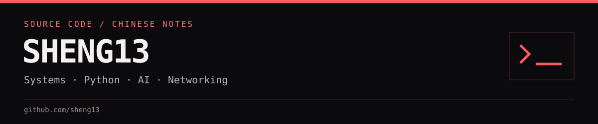

# 嗨，我是 Sheng

我持續學習 Python、機器學習、AI 工具、網路技術與系統部署，也把實作過程整理成程式碼和中文筆記。這裡收錄網站、遊戲、部署文件與課程練習；各專案的使用方法和限制放在自己的 README。

[目前關注](#目前關注) · [精選專案](#精選專案) · [公開專案導覽](#公開專案導覽) · [交流與回報](#交流與回報)

## 目前關注

| 方向 | 內容 |
| --- | --- |
| 系統與部署 | Docker、GitLab、Gitea 與自架服務的設定、備份和維護筆記 |
| Python 與機器學習 | Python 工具、Jupyter Notebook、課程實驗與資料處理 |
| AI 應用 | Agentic Coding、Gemini、LINE Bot 與網頁介面實驗 |
| 網路學習 | 網路基礎、CCNA 與相關學習文件 |

## 精選專案

| 專案 | 可以找到什麼 |
| --- | --- |
| [IT 資訊聚合網站](https://github.com/sheng13/IT-information) | RSS、GitHub Trending、搜尋與收藏的網站實作 |
| [Python 小遊戲網站](https://github.com/sheng13/games) | 猜數字、五子棋、井字棋與區域網路聯機遊戲 |
| [GitLab 部署指南](https://github.com/sheng13/gitlab-deployment-guide) | 中文部署、備份、恢復與安全操作文件 |
| [AI 五子棋](https://github.com/sheng13/Gomoku-Versions) | AI 棋型評分、限時挑戰、對局歷史與棋譜回放 |
| [Hermes／Ollama／Qwen 指南](https://github.com/sheng13/hermes-ollama-qwen-guide) | 從環境準備到本地工具設定的中文筆記 |
| [留學臺灣指南](https://github.com/sheng13/study-in-taiwan-guide) | 入學、ARC、交通、銀行、工作許可及校園資訊整理 |

## 公開專案導覽

### 系統部署與工具

| 儲存庫 | 內容 |
| --- | --- |
| [gitlab-deployment-guide](https://github.com/sheng13/gitlab-deployment-guide) | GitLab 部署與維護指南 |
| [gitea-standalone](https://github.com/sheng13/gitea-standalone) | Gitea、SQLite、systemd 與備份範例 |
| [hermes-ollama-qwen-guide](https://github.com/sheng13/hermes-ollama-qwen-guide) | Hermes Agent 與本地模型工具的安裝筆記 |
| [check-packages](https://github.com/sheng13/check-packages) | 跨平台套件檢查工具與範例 |
| [install-stsemd](https://github.com/sheng13/install-stsemd) | Linux 使用者層級服務操作筆記，保留原儲存庫名稱 |

### 網站、遊戲與生活指南

| 儲存庫 | 內容 |
| --- | --- |
| [IT-information](https://github.com/sheng13/IT-information) | IT 資訊聚合網站 |
| [games](https://github.com/sheng13/games) | Flask 小遊戲網站 |
| [Gomoku-Versions](https://github.com/sheng13/Gomoku-Versions) | 五子棋實驗版本與整合實作 |
| [study-in-taiwan-guide](https://github.com/sheng13/study-in-taiwan-guide) | 留學臺灣的生活資訊指南 |
| [review-study-taiwan-improved-study-taiwan-](https://github.com/sheng13/review-study-taiwan-improved-study-taiwan-) | 臺灣留學資訊專案的加密備份分片，不是可直接瀏覽的網站 |

### AI 與網頁實驗

| 儲存庫 | 內容 |
| --- | --- |
| [agent_web](https://github.com/sheng13/agent_web) | Agent Web 網頁介面與實驗頁面 |
| [Agentic-Coding](https://github.com/sheng13/Agentic-Coding) | Agentic Coding 任務與 Tetris 實作紀錄 |
| [gemini-line-bot-labs](https://github.com/sheng13/gemini-line-bot-labs) | Gemini、LINE Bot、工具呼叫與 RAG 實驗 |
| [colab-flask-ngrok-lab](https://github.com/sheng13/colab-flask-ngrok-lab) | Colab、Flask 與 ngrok 網頁服務實驗 |

### 課程與學習文件

| 儲存庫 | 內容 |
| --- | --- |
| [MachineLearning](https://github.com/sheng13/MachineLearning) | 決策樹、隨機森林與機器學習課程筆記 |
| [MachineLearning1](https://github.com/sheng13/MachineLearning1) | Weka 分類實驗與操作截圖 |
| [school-project](https://github.com/sheng13/school-project) | 機器學習課程與 AI 作業 |
| [nvidia](https://github.com/sheng13/nvidia) | NVIDIA 相關中文／英文學習 PDF，並非官方考試成績證明 |
| [import_math.py](https://github.com/sheng13/import_math.py) | 使用 Tkinter 與心形座標的提示視窗練習 |

## 交流與回報

歡迎透過各專案的 GitHub Issues 提問、回報問題或分享建議。若專案尚未開啟 Issues，可先閱讀該儲存庫的聯絡與貢獻說明。

公開頁面只列出公開專案。課程練習、範例程式與操作筆記不等同於正式部署驗證、專業認證或產品支援承諾；使用前請閱讀各專案的環境需求與注意事項。
